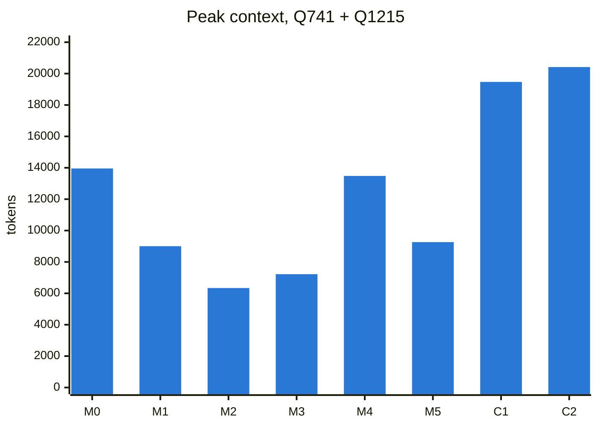
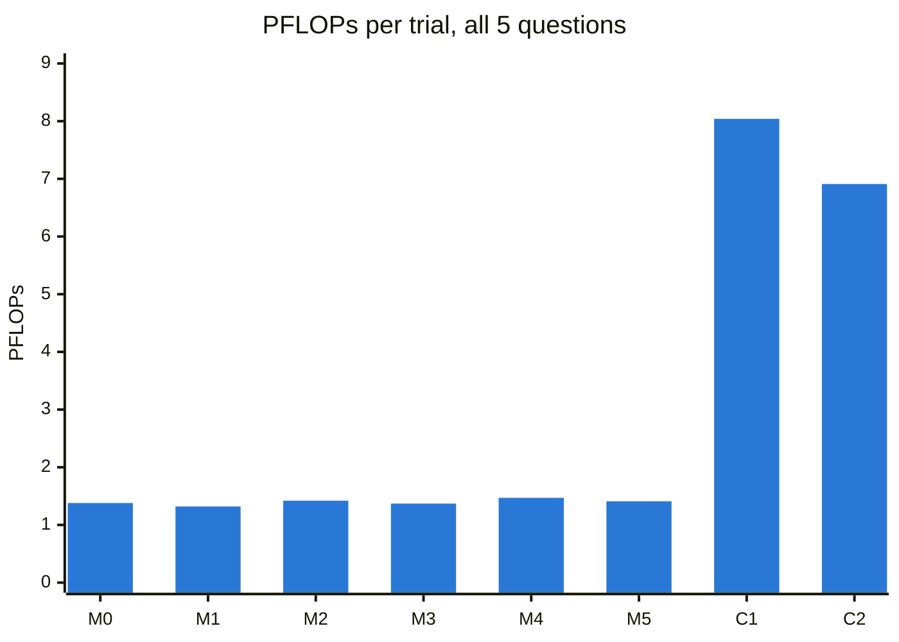
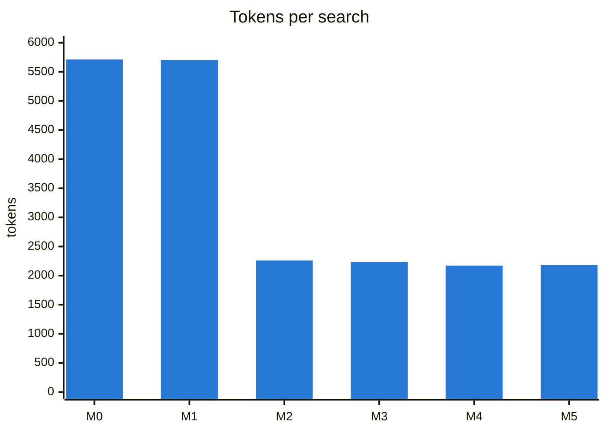
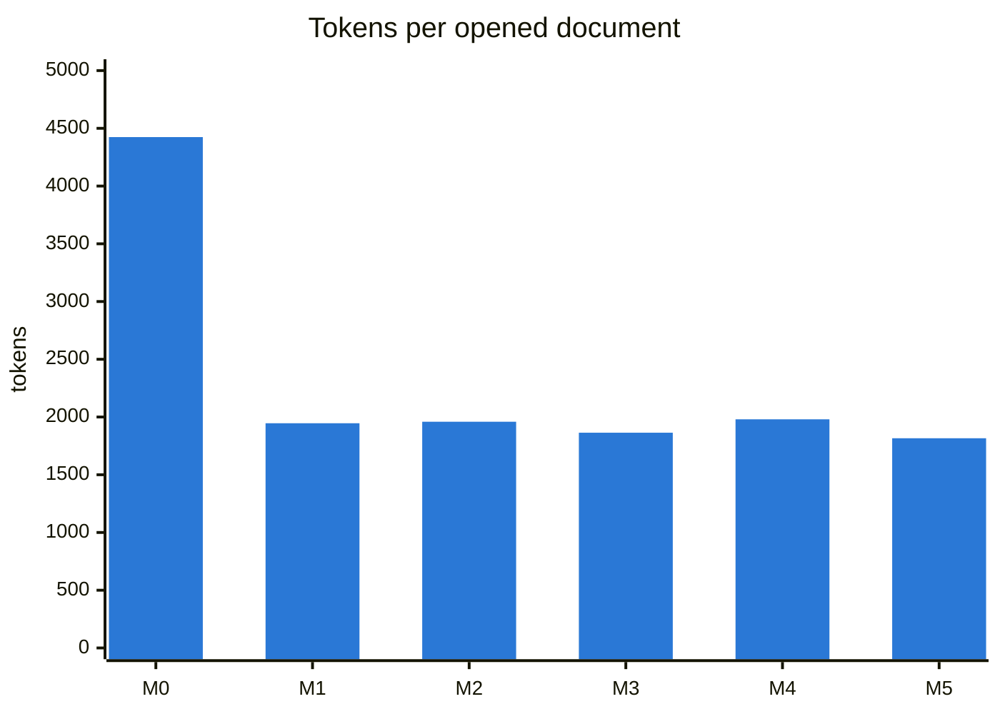

# Study 2 · Jev classification of search results and documents vs CLM on BrowseComp-Plus (2026-10-25)

> **In one line:** 5 BrowseComp-Plus questions × 3 repeats × 8 methods (the baseline, five Jev-classification
> arms M1–M5, and CLM zero-shot / instructed C1–C2), all under the CLM paper's protocol with the official
> Lucene BM25: **does classifying what the agent reads cut its context without hurting accuracy?**

## 0. Bottom line

| | |
|---|---|
| ✅ **Within-budget questions** (741, 1215) | Paging search snippets and documents by Jev relevance cut median **peak context 14.0k → 6.3k–7.2k tokens (−48% to −55%)** and compute **0.8 → 0.5 PFLOPs**, at equal or better accuracy (M3 6/6 vs baseline 5/6). |
| ✅ **Labels only** (M3) | Jev never sees the BCP question, only the agent's topic labels, and does as well as with it (M2): 6/6 vs 5/6 within budget, 6/15 vs 5/15 overall. |
| ➖ **Strict Rank** (M4, M5) | No context gain over Score + Interleave, and lower accuracy on Q1215 (traced to first-query misses, likely sampling noise). Adding the agent's reasoning (M5) changed nothing measurable. |
| ⚠️ **Budget-bound questions** (333, 600, 1226) | Almost every trial of every method hit the 21,512-token limit. Failures were **retrieval** (333, 600: search never returned the evidence) or **recognition** (1226: the gold document was returned and shown on page 1 in 16/18 trials but opened in 1). Classification cannot fix either. |
| ⚖️ **CLM** (C1, C2) | Same accuracy band as ours (6/15 each vs 4–7/15), at **~5× the compute** (median 6.9–8.0 vs 1.3–1.5 PFLOPs per trial) and 3–8× the total input tokens. |
| 🔬 **Caveat** | n = 3 per cell. Accuracy differences between methods are within noise; the context and compute differences on within-budget questions are consistent across repeats. |

## 1. What ran

| ID | Method | What the agent gets |
|---|---|---|
| **M0** | `full` | Baseline: 10 search snippets (≈5.7k tokens) per search; documents whole (≤ 8,192 tokens). No classification. |
| **M1** | `ranked_doc` | Documents cut into 400-token chunks, scored by Jev **Score + Interleave** (SI), served in ≤ 2,000-token pages, best first. Jev gets the question. Search unchanged. |
| **M2** | `ranked_doc_search` | M1 **plus search snippets** cut into ~100-token chunks and paged the same way (page 1 + the 10 docids; `next_results` for more). |
| **M3** | `ranked_doc_search_labels` | M2 with **labels only**: Jev never sees the BCP question, only the topic labels the agent writes. |
| **M4** | `strict_rank_search_labels` | **Strict Rank** (SR): one Jev `choice` orders all chunks 1…N; pages follow that order; **no scores shown**. Labels only. |
| **M5** | `strict_rank_search_reasoning` | M4 plus the **agent's own reasoning** for that call, handed to Jev. |
| **C1** | `clm` | CLM (Context Language Models), zero-shot: the model edits its own context file. |
| **C2** | `clm_instructed` | CLM plus the paper's Appendix E instruction: compact to ~4,000 tokens whenever context exceeds 16,000. |

**Trials:** 5 questions × 8 methods × 3 repeats = 120, all completed, none excluded. Every trial starts from an empty
context with its own gateway run ID and its own Jev cache. Arm order rotates between repeats.

## 2. Protocol (identical for every method)

| Setting | Value |
|---|---|
| Model | Qwen3.8-27B on Purdue GenAI Studio; temperature 0.7, top_p 0.95, thinking on, 4,096 output tokens per call |
| Retrieval | Official Lucene BM25 (BrowseComp-Plus prebuilt index, 100,195 documents); top 10 hits; 512-token snippets; 8,192-token documents; Qwen3-0.6B cutting tokenizer |
| Budget | 23,560 tokens with a 2,048 reserve → **prompt limit 21,512**. Crossing it buys one final turn with CLM's notice, then the run ends |
| Turns | 100 |
| Chunking | chunk = 0.2 × the unit: 400 tokens for documents (unit = 2,000-token page), 102 for snippets (unit = 512-token snippet); pages ≤ 2,000 tokens |
| Jev | TypeSafe `jev-latest` (System One): `noul` (yes probability) for SI; `choice` (probabilities over chunk IDs) for SR |
| Compute | Prefix-reuse FLOPs (CLM Eq. 9, 16-token blocks), validated on every trial |
| Grading | **Correct** = the normalized gold answer is contained in the answer, and the agent did not abstain. Exact match shown alongside. The LLM judge (`qwen3:32b`) was unreachable all day (§9) |
| When | 2026-10-25, 19:47–23:39 UTC |

**Terms.** *Peak context*: the largest single prompt the agent was sent. *Input tokens*: the sum of all prompts in a
trial (grows with every turn). *PFLOPs*: 10¹⁵ floating-point operations, after reusing cached prompt prefixes.
*Evidence / gold document*: documents BrowseComp-Plus marks as holding the needed facts / the answer, read only
after a trial ends.

## 3. Headline numbers

**All 5 questions** (medians per trial):

| ID | Method | Correct | Exact | Answered | Peak context | Input tokens | PFLOPs | Calls |
|---|---|---|---|---|---|---|---|---|
| M0 | `full` | **5/15** | 4/15 | 6/15 | 23,872 | 61,829 | 1.4 | 5 |
| M1 | `ranked_doc` | **7/15** | 6/15 | 8/15 | 22,595 | 63,472 | 1.3 | 5 |
| M2 | `ranked_doc_search` | **5/15** | 4/15 | 9/15 | 22,487 | 119,071 | 1.4 | 10 |
| M3 | `ranked_doc_search_labels` | **6/15** | 4/15 | 9/15 | 22,193 | 117,785 | 1.4 | 10 |
| M4 | `strict_rank_search_labels` | **4/15** | 3/15 | 7/15 | 21,690 | 120,784 | 1.5 | 10 |
| M5 | `strict_rank_search_reasoning` | **5/15** | 4/15 | 7/15 | 21,622 | 114,900 | 1.4 | 10 |
| C1 | `clm` | **6/15** | 4/15 | 15/15 | 21,111 | 355,182 | 8.0 | 25 |
| C2 | `clm_instructed` | **6/15** | 6/15 | 14/15 | 20,303 | 488,016 | 6.9 | 38 |

**Within-budget questions (741, 1215)**, where most trials finished before the limit, so peak context measures
what the method needed rather than the limit:

| ID | Method | Correct | Peak context | vs M0 | PFLOPs | Search tokens per search | Tokens per opened document |
|---|---|---|---|---|---|---|---|
| M0 | `full` | **5/6** | 13,956 | – | 0.83 | 5,759 | 4,424 |
| M1 | `ranked_doc` | **6/6** | 9,004 | -35% | 0.51 | 5,700 | 1,926 |
| M2 | `ranked_doc_search` | **5/6** | 6,338 | -55% | 0.52 | 2,291 | 1,959 |
| M3 | `ranked_doc_search_labels` | **6/6** | 7,220 | -48% | 0.50 | 2,228 | 2,058 |
| M4 | `strict_rank_search_labels` | **4/6** | 13,479 | -3% | 0.84 | 2,172 | 1,985 |
| M5 | `strict_rank_search_reasoning` | **4/6** | 9,263 | -34% | 0.58 | 2,166 | 1,980 |
| C1 | `clm` | **5/6** | 19,470 | +40% | 2.68 | – | – |
| C2 | `clm_instructed` | **3/6** | 20,416 | +46% | 3.42 | – | – |

## 4. Charts

**Peak context, within-budget questions** (median tokens; lower is better; the limit is 21,512):

**Compute per trial, all questions** (median PFLOPs; lower is better):

**What one tool call costs the agent** (median tokens, all questions; CLM has no comparable split):

Chart data as a table

| ID | Peak (741+1215) | PFLOPs (all) | Tokens per search | Tokens per opened document |
|---|---|---|---|---|
| M0 | 13,956 | 1.38 | 5,713 | 4,424 |
| M1 | 9,004 | 1.32 | 5,703 | 1,946 |
| M2 | 6,338 | 1.42 | 2,260 | 1,959 |
| M3 | 7,220 | 1.37 | 2,236 | 1,864 |
| M4 | 13,479 | 1.47 | 2,172 | 1,980 |
| M5 | 9,263 | 1.41 | 2,181 | 1,816 |
| C1 | 19,470 | 8.04 | – | – |
| C2 | 20,416 | 6.91 | – | – |

## 5. Every trial

✓ correct · ✗ wrong answer · – abstained or no answer · one mark per repeat (r1 r2 r3)

| Q | M0 | M1 | M2 | M3 | M4 | M5 | C1 | C2 |
|---|---|---|---|---|---|---|---|---|
| **741** | – ✓ ✓ | ✓ ✓ ✓ | ✓ ✓ ✓ | ✓ ✓ ✓ | ✓ ✓ ✓ | ✓ ✓ ✓ | ✓ ✓ ✓ | ✓ ✓ ✓ |
| **333** | – – – | – – ✓ | – – – | – – – | – – – | – – – | ✗ ✗ ✗ | ✗ ✗ ✗ |
| **600** | – – – | – – – | – – ✗ | – – – | – – – | – – – | ✗ ✗ ✗ | ✓ ✗ ✓ |
| **1226** | ✗ – – | ✗ – – | – ✗ ✗ | ✗ ✗ ✗ | – – ✗ | – – ✓ | ✗ ✗ ✓ | ✓ ✗ – |
| **1215** | ✓ ✓ ✓ | ✓ ✓ ✓ | ✗ ✓ ✓ | ✓ ✓ ✓ | ✗ ✓ ✗ | ✓ ✗ ✗ | ✗ ✓ ✓ | ✗ ✗ ✗ |
| **total** | **5/15** | **7/15** | **5/15** | **6/15** | **4/15** | **5/15** | **6/15** | **6/15** |

- **741** (short evidence) is easy for everyone; classification makes it cheap.
- **1215** (long gold documents) is where document ranking matters: documents arrive as ~1.8k-token pages instead of ~6.1k-token wholes.
- **333, 600, 1226** are budget-bound for every method (§6).

## 6. Why the hard questions failed: retrieval and recognition

Trials in which search **returned** / the agent **opened** an evidence document (evaluation only):

| Q | M0 | M1 | M2 | M3 | M4 | M5 | C1 | C2 |
|---|---|---|---|---|---|---|---|---|
| **741** | 2 / 2 | 3 / 3 | 3 / 3 | 3 / 3 | 3 / 3 | 3 / 3 | 3 / 3 | 3 / 3 |
| **333** | 0 / 0 | 1 / 1 | 0 / 0 | 0 / 0 | 0 / 0 | 0 / 0 | 0 / 0 | 0 / 0 |
| **600** | 1 / 0 | 0 / 0 | 0 / 0 | 0 / 0 | 0 / 0 | 0 / 0 | 0 / 0 | 2 / 2 |
| **1226** | 3 / 0 | 3 / 0 | 2 / 0 | 3 / 0 | 3 / 0 | 2 / 1 | 3 / 0 | 3 / 1 |
| **1215** | 3 / 2 | 3 / 3 | 2 / 2 | 3 / 2 | 1 / 1 | 1 / 1 | 3 / 2 | 0 / 0 |

1. **Q333, Q600, retrieval.** Our search returned an evidence document in 1 of 18 trials each. The paged arms used
   the budget for ~9 searches instead of ~4, but the queries did not hit. C2's two correct Q600 trials are exactly
   the two CLM trials whose searches returned an evidence document.
2. **Q1226, recognition.** The gold document was returned in 16 of 18 of our trials, and in every paged arm its
   snippet was on page 1. Only 1 trial opened it (M5 r3, the only correct one). The wrong answers are genuinely
   different from the gold (string similarity 0.12–0.32), not formatting misses.
3. **Cost of paging on budget-bound questions.** A paged search costs ~2.2k tokens instead of ~5.7k, so the same
   budget buys ~2.2× more searches. That roughly **doubles total input tokens** (≈118k vs ≈62k median) without
   adding correct answers, while PFLOPs stay level (1.4–1.5), because the repeated prefix is cached.

## 7. Paired comparisons (each changes one thing)

| Change | From → to | Peak context (741+1215) | PFLOPs (741+1215) | Correct (741+1215) | Correct (all) |
|---|---|---|---|---|---|
| Rank documents | M0 → M1 | 13,956 → 9,004 (-35%) | 0.83 → 0.51 | 5/6 → 6/6 | 5/15 → 7/15 |
| Also page search snippets | M1 → M2 | 9,004 → 6,338 (-30%) | 0.51 → 0.52 | 6/6 → 5/6 | 7/15 → 5/15 |
| Hide the question from Jev | M2 → M3 | 6,338 → 7,220 (+14%) | 0.52 → 0.50 | 5/6 → 6/6 | 5/15 → 6/15 |
| Strict Rank, no scores (bundled) | M3 → M4 | 7,220 → 13,479 (+87%) | 0.50 → 0.84 | 6/6 → 4/6 | 6/15 → 4/15 |
| Give Jev the agent's reasoning | M4 → M5 | 13,479 → 9,263 (-31%) | 0.84 → 0.58 | 4/6 → 4/6 | 4/15 → 5/15 |
| CLM zero-shot instead of the baseline | M0 → C1 | 13,956 → 19,470 (+40%) | 0.83 → 2.68 | 5/6 → 5/6 | 5/15 → 6/15 |
| CLM instructed instead of the baseline | M0 → C2 | 13,956 → 20,416 (+46%) | 0.83 → 3.42 | 5/6 → 3/6 | 5/15 → 6/15 |

**How to read this.** A median over 6 trials moves a lot when one or two trials run to the limit, so read the peak
and PFLOPs columns together with the correct counts:
- **M3 → M4:** M4's higher within-budget peak comes from its two Q1215 trials whose first query missed and ran to
  the limit (§5), not from the ranking itself. On Q741 alone, where every method found the evidence, the median
  peaks are M0 15,524 · M1 15,133 · M2 6,462 · M3 8,430 · **M4 5,864** · M5 8,114 · C1 20,319 · C2 19,902.
- **M4 → M5:** the change is driven by the same Q1215 trials; there is no consistent effect of the reasoning.
- **Hits depend only on the query.** Ranking changes what the agent reads, never which 10 documents come back;
  the first search returned an evidence document in 6/12 SR trials vs 6/18 SI trials (M1–M3) on Q741 + Q1226,
  but in 1/6 vs 8/9 on Q1215. With temperature 0.7 and 3 repeats, we read Q1215 as query variance, to recheck.

## 8. Jev usage

| | SI arms (M1–M3) | SR arms (M4–M5) |
|---|---|---|
| Requests | 203 | 206 |
| Tokens per request (input + output, mean) | ≈26k (M2, M3); ≈10k (M1, documents only) | ≈9k |
| Median latency | 281–350 ms | 245–257 ms |

**Total:** 409 Jev requests, 7.0M tokens, **≈ $0.30** at $0.042 per million input tokens. No Jev request failed.
SR asks one question per unit instead of one per (chunk, topic), so its requests are about a third the size.

## 9. Safeguards and disclosures

**No leaks.**
- The agent sees only the system text, the question and tool outputs; it can open only docids search returned.
- Jev sees the question (M1, M2 only), the agent's topic labels, the agent's reasoning (M5) and corpus text.
- CLM task folders hold only the task text and the question; an automated test checks they hold no answer.
- Gold answers and gold/evidence docids are read only after a trial ends; an automated test scans every agent
  and Jev request for them.

**Disclosed.**
- **Question selection:** Q1226 and Q1215 were chosen *because* their gold documents are long (5.5k–25k tokens),
  using answer-key knowledge. This stratifies for the long-document hypothesis and may favour ranking.
- **Judge:** `qwen3:32b` timed out on every check (latest probe: no reply in 180 s, 22:20 UTC). Grading is contains-gold, which is
  lenient on format (CLM often writes longer answers: C1 has 6 contains vs 4 exact).
- **Abstentions count as incorrect**, even when the best guess matches (1 trial: M0 r2 on Q600).
- **Over-limit prompts.** Our arms exceed 21,512 only on the final turn (55 trials, max 24,700). In 4 of 30 CLM
  trials one prompt went above 23,000 mid-run (23,129–31,038), each followed by a rollback in CLM's own budget
  code, as released; we did not change it. 3 of those 4 trials were wrong.
- **Model failure counted, not excluded:** M5 r2 on Q1226 twice spent all 4,096 output tokens thinking and made no
  tool call (`invalid_action_limit`). Only provider errors are excluded; there were none.
- **Missing or excluded trials:** none; all 120 trials completed.

## 10. Limitations

- 5 questions, 3 repeats: enough to see direction, not to rank close methods.
- One model (Qwen3.8-27B) and one retriever (BM25); a stronger retriever would change the hard questions most.
- The harnesses differ: CLM works through Bash and skill commands; our arms use function tools and their own prompts.
- Contains-gold grading instead of the BrowseComp-Plus judge.

## 11. Next steps (recorded, not run)

1. **Recognition:** a one-line notice when a page holds a high-relevance chunk from an unopened document (Q1226).
2. **Retrieval:** query-rewrite help or a dense retriever for the budget-bound questions (Q333, Q600).
3. **Relevance floor** and **predicates instead of topics** for SR; per-topic SR; chunk-size sweep (ratio 0.1–0.4).
4. **Study 3:** DeepSWE feasibility (Docker, one image, one Pier grade).

## 12. Files

- Code: `benchmarks/bcp/doc_labeling/search_pilot.py` (arms M0–M5), `benchmarks/bcp/run.py` and `tasks.py` (C1, C2).
- Ledger: [`docs/bcp-research-ledger.md`](../../bcp-research-ledger.md) (L7 design, L9 smoke test, L10–L13 per question).
- Raw traces stay private (BrowseComp-Plus canary); this page holds aggregate numbers only.
